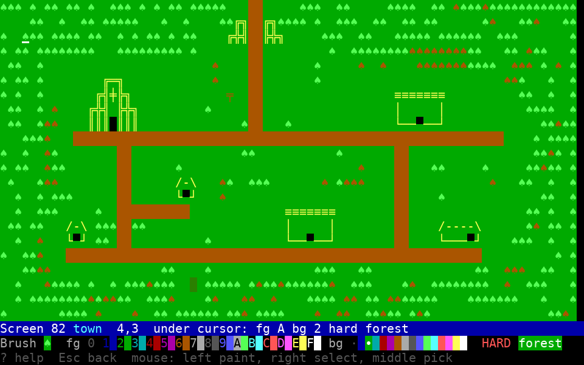
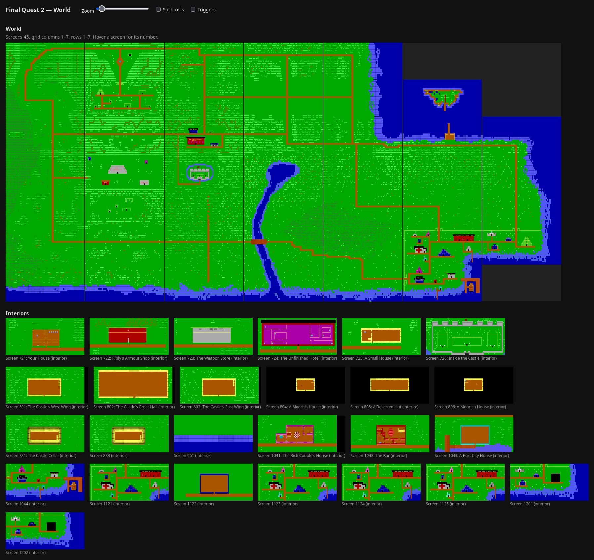

# @fq2ts/tools

Map tools for `@fq2ts/engine` games: a viewer (the world as an HTML page), a
level editor in the terminal, and a terrain generator. Each tool's `main`
takes the game's `GameFiles` (its map folder, and the trigger tiles and
encounter tables to show); see Final Quest 2's [tools/](https://github.com/ellisgl/FQ2TS/tree/main/tools).

## Using it

```sh
bun add @fq2ts/tools@github:ellisgl/fq2ts-tools#v0.1.0
```

It ships its TypeScript source, which Bun runs as it is.





## Development

```sh
bun install
bun run check          # tsc (strict) + eslint + tests
```
